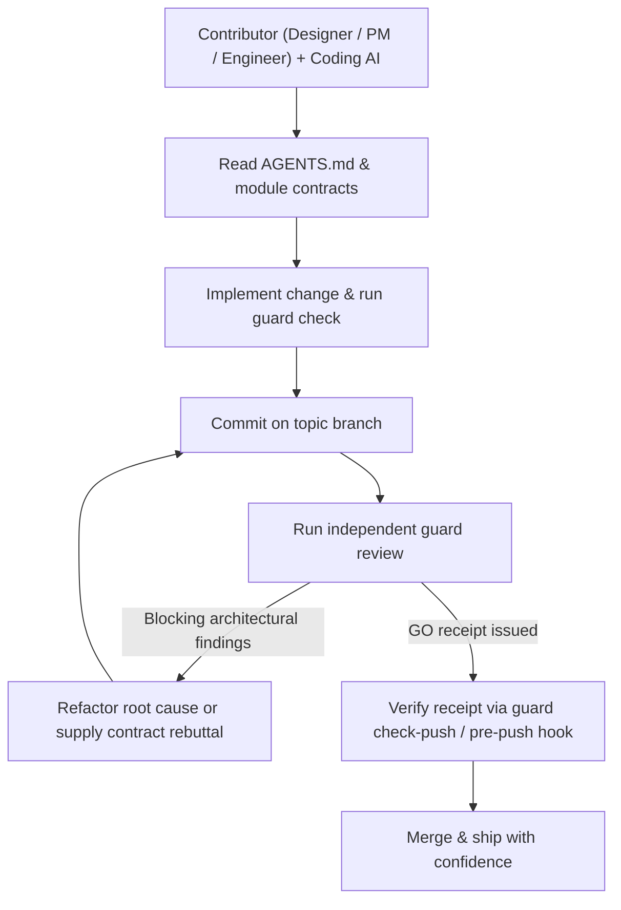

# the-guard

[](LICENSE)
[](pyproject.toml)
[](pyproject.toml)
[](https://skills.sh/sensebeing/the-guard)
[](https://github.com/sensebeing/the-guard/stargazers)

**Let your whole team build with AI.**

Architecture guardrails for teams building software with AI.

When anyone can generate a working patch with an AI agent, the hard part is keeping the codebase coherent. A feature can pass tests while placing a business rule in the wrong service, duplicating a state machine, or leaving a replaced code path alive.

`the-guard` puts your team's architecture rules in the repository so coding agents read them before writing code, deterministic checks catch structural regressions during edits, and a separate reviewer agent challenges committed changes before merge.

| Without `the-guard` | With `the-guard` |
| --- | --- |
| A coding agent adds an order-status badge by recalculating status rules inside a UI component, or fixes a bug by wrapping a broken query in a retry loop. Unit tests and linters pass, so the shortcut merges into `main`. | The agent reads `AGENTS.md` and module owner docs before editing. `guard check` blocks forbidden imports and SQL ownership violations during edits, and `guard review` runs a separate reviewer agent before merge that cites `guard.single-source-of-truth` and requires a root-cause fix at the owner boundary. |

[中文文档](README.zh-CN.md) · [Quick start](#quick-start) · [Presets & rules](#presets-and-the-14-engineering-quality-rules) · [Workflow](#workflow) · [Configuration](#configuration) · [Setup skill](skills/the-guard-setup/SKILL.md) · [Daily skill](skills/the-guard/SKILL.md) · [Benchmarks](#benchmarks)

## Get started in 30 seconds: paste to your agent

Paste this into Claude Code, Codex, Cursor, Antigravity, or Orca:

```text
Install and set up https://github.com/sensebeing/the-guard for this repository.
Install the CLI (`uv tool install git+https://github.com/sensebeing/the-guard` or `python3 -m pip install git+https://github.com/sensebeing/the-guard`),
install the skills (`npx skills add sensebeing/the-guard --global --agent '*'` or symlink from a checkout),
then follow skills/the-guard-setup/SKILL.md to help me choose an onboarding mode (core, full, distill, or hybrid) and verify guard check.
```

## Why we built it

On our team, our product designer uses her own ChatGPT and coding agent to ship production code every day. Once designers, product managers, domain experts, and engineers all contribute through their own agents, a senior architect cannot sit behind every pull request.

Tests check behavior, and linters, formatters, and static analyzers catch style issues and local bug patterns. A green CI pipeline still cannot tell whether a UI component recreated a backend state machine, or whether a bug fix stacked a retry loop over a broken data model.

`the-guard` records those expectations in the repository: which module owns each business decision, which old tables and code paths must be deleted when a replacement lands, and whether a change fixes the root cause at the owner boundary.

## Three defenses, one set of rules

| Stage | Defense | What it does |
| --- | --- | --- |
| 1. Before coding | Rules in `AGENTS.md` / `CLAUDE.md` | Gives the coding agent the policy manifest and module ownership contracts before implementation starts. |
| 2. During editing | Deterministic topology checks and ratchets | Checks module import boundaries, exclusive SQL table ownership, retired-table ratchets, and AST or lexical anti-patterns via `guard check`. |
| 3. Before merge | Independent adversarial agent review | Runs a separate reviewer agent (`codex`, `claude`, or `agy`) on committed Git snapshots to challenge ownership, call topology, and root-cause design before issuing a push receipt. |

## Quick start

### 1. Install

Install the `guard` CLI with Python 3.11+ and Git:

```sh
uv tool install git+https://github.com/sensebeing/the-guard
# or with pip:
python3 -m pip install git+https://github.com/sensebeing/the-guard
```

Install the agent skills (`$the-guard` and `$the-guard-setup`) for Claude Code, Codex, Cursor, Gemini CLI, GitHub Copilot, or Windsurf:

```sh
npx skills add sensebeing/the-guard --global --agent '*'
```

In Claude Code, you can also install via the plugin marketplace:

```text
/plugin marketplace add sensebeing/the-guard
/plugin install the-guard@the-guard
```

The CLI has no external runtime dependencies. Independent review uses a locally installed `codex`, `claude`, or `agy` CLI.

### 2. Initialize

Inside your Git repository:

```sh
guard init --preset core
guard topology sync
guard check --policy-only
```

This installs the four core rules (Architecture Simplicity, Single Source of Truth, Service Boundaries, and Code Organization), discovers your module inventory, and validates the policy manifest.

To install all 14 rules and enable the local `pre-push` gate:

```sh
guard init --preset full --with-hooks
```

### 3. Or run the setup skill

Invoke `$the-guard-setup` (or `/the-guard-setup`) in your coding agent to choose `core`, `full`, `distill`, or `hybrid` interactively.

## Presets and the 14 engineering quality rules

| Mode | Best fit | What you get |
| --- | --- | --- |
| `core` | Recommended default (4 rules) | Universal architectural invariants: Single Source of Truth, Architecture Simplicity, Service Boundaries, and Code Organization. |
| `full` | Production full-stack (14 rules) | All 4 Core rules plus 10 rules covering data modeling, SQL and call-topology efficiency, event-driven execution, process metadata separation, explicit failure handling, frontend design systems, agent/skill/prompt contracts, LLM contracts, tool schemas, and test quality. |
| `distill` | Codebase-derived | `guard distill` inspects existing modules, tooling, and code samples so your agent can draft rules tailored to your codebase. |
| `hybrid` | Core + codebase topology | The 4 Core rules combined with codebase-distilled module boundaries, SQL table owners, and retired-table ratchets. |

`core` and `full` are built-in `guard init --preset` values; `distill` and `hybrid` are agent-guided workflows. Confirm discovered module boundaries before enforcing them as blocking rules.

### Core preset (4 rules)

| Rule | Focus area | Core invariant |
| --- | --- | --- |
| `guard.architecture-simplicity`<br>[Architecture Simplicity](src/the_guard/presets/rules/architecture-simplicity.md) | Ownership and write convergence | One explicit owner per responsibility and write decision; converge on write, read directly without write locks or reverse-fetching; delete replaced mechanisms instead of stacking defensive rechecks. |
| `guard.single-source-of-truth`<br>[Single Source of Truth](src/the_guard/presets/rules/single-source-of-truth.md) | Canonical state and cutover | One executable definition per business rule, state machine, vocabulary, and filter; complete reader cutover and legacy deletion in the same change without dual-track fallback reads. |
| `guard.service-boundaries`<br>[Service Boundaries](src/the_guard/presets/rules/service-boundaries.md) | Module boundary contracts | Each module performs only the responsibilities declared in its owner contract; shared libraries and UI never duplicate vertical domain logic. |
| `guard.code-organization`<br>[Code Organization](src/the_guard/presets/rules/code-organization.md) | Cohesion and acyclic structure | Cohesive module, class, and method responsibilities, acyclic dependencies, top-level imports, and dead-code deletion; no mechanical file splitting or MRO method shadowing. |

### Full preset additions (10 rules)

| Rule | Focus area | Core invariant |
| --- | --- | --- |
| `guard.data-modeling`<br>[Data Modeling](src/the_guard/presets/rules/data-modeling.md) | Schema and retired tables | Explicit schema owner and stable semantics; derived data never becomes a competing truth; retired tables are delete-only. |
| `guard.database-query-efficiency`<br>[Database Query Efficiency](src/the_guard/presets/rules/database-query-efficiency.md) | Call fan-out, N+1, and locks | Control end-to-end call fan-out and SQL cost; no duplicate read-only fetches in one action, no N+1 awaited reads in loops, no RPC/LLM calls inside DB locks, and CAS/version checks on lock-free settlement. |
| `guard.event-driven-execution`<br>[Event-driven Execution](src/the_guard/presets/rules/event-driven-execution.md) | Events, watermarks, and queues | Real events or messages drive execution; async work queues guarantee single-watermark discovery, terminal settlement per row, and starvation prevention; no unapproved polling or timers. |
| `guard.process-adjunct-not-truth`<br>[Process Adjunct, Not Truth](src/the_guard/presets/rules/process-adjunct-not-truth.md) | Business truth vs. metadata | Build fingerprints, prompt versions, and runtime metadata are process adjuncts, not business truth; recovery and continuation rely on business obligations and safe retryability. |
| `guard.no-silent-fallback`<br>[No Silent Fallback](src/the_guard/presets/rules/no-silent-fallback.md) | Explicit failure handling | Never fabricate facts or mask failures behind silent defaults; isolate unknown parts and block only affected unsafe operations. |
| `guard.frontend-product-surface`<br>[Frontend Product Surface](src/the_guard/presets/rules/frontend-product-surface.md) | Design system consumption | Consume design system, components, and pages in order; keep business state, navigation, and presentation in their respective owners. |
| `guard.agent-skill-prompt`<br>[Agent, Skill and Prompt Contracts](src/the_guard/presets/rules/agent-skill-prompt.md) | Prompt and runtime symmetry | Keep skills, prompts, tool schemas, and runtime gates symmetric; runtime injects deterministic context, code enforces hard safety gates, and prompts never copy state machines or schemas. |
| `guard.llm-contract-quality`<br>[LLM Input and Contract Quality](src/the_guard/presets/rules/llm-contract-quality.md) | Model input and output schemas | Distinguish confirmed facts from candidates in model inputs; normalize valid variants, preserve parse/refusal diagnostics, and never guess identity or business facts. |
| `guard.tool-authoring`<br>[Tool Authoring](src/the_guard/presets/rules/tool-authoring.md) | Flat tool schemas and lifecycle | One domain resource and homogeneous authorization per tool; flat action-discriminated schemas (no nested envelopes, parallel arrays, or open dicts); expose intent parameters only and remove retired tools end-to-end. |
| `guard.test-case-quality`<br>[Test Case Quality](src/the_guard/presets/rules/test-case-quality.md) | High-signal invariant tests | Resident tests protect core business invariants and state what failure means; assert observable behavior rather than mock-only calls or source-text mirrors. |

## Workflow



1. The coding agent reads root policies in `AGENTS.md` and touched modules' owner docs before editing.
2. Run `guard check --base origin/main` during development to catch boundary or AST violations early.
3. Commit changes on a topic branch and run `guard review` so a separate reviewer agent audits the committed diff against your rules.
4. When the reviewer flags a structural issue, fix the root cause across the pattern, or rebut with code and contract evidence via `guard review --note "<evidence>"`.
5. Run `guard check-push` (or use the `pre-push` hook installed by `--with-hooks`) to verify that a valid `GO` receipt matches the committed patch before pushing to `main`.

### An example from daily work

Suppose a designer asks her coding agent to add an order-status badge to a screen, and the agent computes the status rule inside the UI component instead of using the orders service that already owns that logic.

A linter sees valid syntax and types. `guard check` blocks forbidden cross-layer imports deterministically, and `guard review` cites the orders service contract under `guard.single-source-of-truth` and asks the agent to consume the backend's canonical status field. The designer hands that feedback to her agent, switches the UI to read the backend field, reruns `guard review` for a `GO` receipt, and merges cleanly.

### GitHub Action

Use `sensebeing/the-guard@main` in a workflow to run checks and publish attributable PR reviews.

```yaml
- uses: sensebeing/the-guard@main
```

## Where it fits

| Tool category | What it does best | What `the-guard` adds |
| --- | --- | --- |
| Linters and formatters ([Ruff](https://github.com/astral-sh/ruff), ESLint) | Fast checks for syntax, style, formatting, and local bug patterns. | Semantic ownership rules and cross-module architectural review. |
| Static and security analyzers ([Semgrep](https://github.com/semgrep/semgrep)) | Pattern-based security and correctness rules. | A shared contract linking agent instructions, module docs, and pre-merge design review. |
| Dependency validators ([dependency-cruiser](https://github.com/sverweij/dependency-cruiser)) | Language-specific dependency graphs and import rules. | Python and Swift topology ratchets paired with LLM architectural review. |
| Coding agents (ChatGPT, Claude Code, Codex) | Write features, refactor code, and fix bugs quickly. | A separate reviewer session that challenges shortcuts before code lands on `main`. |
| AI PR reviewers and context graphs (CodeRabbit, Greptile, PR-Agent, code-review-graph) | Diff bug hunting, PR summaries, and AST call-graph retrieval on pull requests. | One shared contract across pre-coding `AGENTS.md` and module owner docs, zero-token topology and debt ratchets during edits, and adversarial pre-merge review with local push receipts. |

## Benchmarks

The complete 50-PR Martian evaluation artifacts are published at [sensebeing/code-review-benchmark](https://github.com/sensebeing/code-review-benchmark), including [benchmark_data.json](https://github.com/sensebeing/code-review-benchmark/blob/main/offline/results/benchmark_data.json) and the [interactive dashboard](https://github.com/sensebeing/code-review-benchmark/blob/main/offline/analysis/benchmark_dashboard.html).


This README uses two tracks and Codex 6.1 (gpt-6.1-sol, effort=medium). Track 1 is the reproducible GuardBench in [benchmarks/guardbench.py](benchmarks/guardbench.py); Track 2 uses Martian's public [code-review-benchmark](https://github.com/withmartian/code-review-benchmark) plus three same-commit comparisons. Full cases and commands are in [benchmarks/README.md](benchmarks/README.md).

### Track 1 - GuardBench

Seven multi-service commits contain 12 violations across seven tools: Ruff, Semgrep 1.185, code-review-graph, deterministic guard check, Claude Code raw, Codex 6.1 raw, and the complete the-guard path.

| Tool | Corrupt cases caught | Violation recall | Clean case-7 false positives | Noise / anti-architectural fixes | Rule-ID attribution |
| --- | ---: | ---: | ---: | --- | ---: |
| Ruff | 0/6 | 0/12 | 0 | 0 | 0% |
| Semgrep 1.185.0 | 0/6 | 0/12 | 0 | 0 | 0% |
| code-review-graph | 0/6 | 0/12 | 0 | 0 | 0% |
| guard check | 4/6 (66.7%) | 5/12 (41.7%) | 0 | 0 | 100% |
| Claude Code raw | 6/6 | 11/12 (91.7%) | 0 | 6 speculative findings (24%) | 0% |
| Codex 6.1 raw (gpt-6.1-sol) | 6/6 | 7/12 (58.3%) | 0 | 1 anti-architectural build_sha fix (case-6) | 0% |
| the-guard full (gpt-6.1-sol) | 6/6 | 12/12 (100%) | 0 | 0 (12/12 root-cause aligned) | 100% |

### Track 2 - real open-source PRs

Comparison across real open-source PRs from Martian's public [code-review-benchmark](https://github.com/withmartian/code-review-benchmark) and ReviewBench (`the-guard` and `Codex 6.1 raw` evaluated locally with `gpt-6.1-sol` across the 6-PR real-PR suite; third-party products from Martian's 50-PR aggregate):

| Product | Evaluated scope | Precision | Recall | F1 |
| --- | --- | ---: | ---: | ---: |
| **the-guard (full + agy gemini-4-carbon-high, Core 158)** | **Martian 50-PR Code Review Bench** | **59.1%** | **75.9% (#1)** | **66.5% (#1)** |
| **the-guard (full + agy gemini-4-carbon-high, All-173)** | **Martian 50-PR Code Review Bench** | **59.7% (#1)** | **71.1% (#1)** | **64.9% (#1)** |
| **the-guard (full + agy gemini-4-carbon-high, Strict 139)** | **Martian 50-PR Code Review Bench** | **56.9%** | **77.0%** | **65.4%** |
| Cubic v2 | Martian 50-PR aggregate | 57.8% | 57.8% | 57.8% |
| Qodo Extended v2 / PR-Agent | Martian 50-PR aggregate | 58.9% | 55.5% | 57.1% |
| Augment | Martian 50-PR aggregate | 50.8% | 58.4% | 54.3% |
| Qodo v2 | Martian 50-PR aggregate | 47.5% | 59.5% | 52.8% |
| Cursor BugBot | Martian 50-PR aggregate | 52.8% | 43.4% | 47.6% |
| GitLab Duo | Martian 50-PR aggregate | 46.9% | 47.4% | 47.1% |
| Devin Review | Martian 50-PR aggregate | 59.3% | 38.7% | 46.9% |
| Greptile v4.1 | Martian 50-PR aggregate | 44.7% | 48.6% | 46.5% |
| Gemini Code Assist v2 | Martian 50-PR aggregate | 40.3% | 51.4% | 45.2% |
| GitHub Copilot Review v2 | Martian 50-PR aggregate | 35.2% | 63.0% | 45.1% |
| Sourcery | Martian 50-PR aggregate | 38.1% | 49.7% | 43.1% |
| Claude Code | Martian 50-PR aggregate | 42.3% | 41.0% | 41.6% |
| CodeRabbit | Martian 50-PR aggregate | 30.7% | 60.1% | 40.6% |
| **the-guard (gpt-6.1-sol)** | **6-PR real-PR suite (3 Martian + 3 ReviewBench)** | **90.0%** | **100.0%** | **94.7%** |
| **Codex 6.1 raw (gpt-6.1-sol)** | **6-PR real-PR suite (3 Martian + 3 ReviewBench)** | **80.0%** | **44.4%** | **57.1%** |

The 6-PR head-to-head gives the-guard 94.7% F1 versus 57.1% for Codex 6.1 raw (gpt-6.1-sol).

Same-commit head-to-head on Martian real open-source PRs ([getsentry/sentry#80168](https://github.com/getsentry/sentry/pull/80168), [calcom/cal.com#22345](https://github.com/calcom/cal.com/pull/22345), [getsentry/sentry#80528](https://github.com/getsentry/sentry/pull/80528)):

| Product | sentry#80168 (2 blocking defects) | cal.com#22345 (2 contract/test defects) | sentry#80528 (clean refactor control) |
| --- | --- | --- | --- |
| **the-guard (gpt-6.1-sol)** | **2/2 + Kafka non-atomic publish (0 FP)** | **2/2 blocking contract & SQL test gaps (0 FP)** | **GO (0 FP)** |
| **Codex 6.1 raw (gpt-6.1-sol)** | 1/2 (missed test assertion mismatch) | 0/2 (false GO) | GO (0 FP) |
| Claude Code | 2/2, 1 FP | 1/2, 2 FP | GO (0 FP) |
| Cursor BugBot | 1/2, 2 FP | 1/2, 1 FP | GO (0 FP) |
| Qodo Extended v2 / PR-Agent | 1/2, 0 FP | 0/2, 0 FP | GO (0 FP) |
| Greptile v4.1 | 1/2, 1 FP | 0/2, 3 FP | GO (0 FP) |
| GitHub Copilot Review v2 | 1/2, 1 FP | 1/2, 3 FP | Legacy issue + style noise |
| CodeRabbit | 1/2, 2 FP | 1/2, 3 FP | Legacy issue + style noise |
| Devin Review | 1/2, 2 FP | 0/2, 0 FP | GO (0 FP) |
| Sourcery | 1/2, 3 FP | 1/2, 0 FP | Legacy issue + style noise |

Reproduce Track 1 with python3 benchmarks/guardbench.py; the command uses no model tokens unless --with-review is supplied.

## Design principles

1. `guard.single-source-of-truth`: Every business rule, state machine, vocabulary, and classification has a single canonical owner. Consumers render or forward results instead of recalculating them.
2. `guard.architecture-simplicity`: Fix root causes at the owner boundary. Delete replaced code paths, legacy tables, and compatibility shims in the same change rather than stacking retries or fallback branches.
3. Preserve real safety boundaries: Simplification keeps authentication, tenant isolation, concurrency locks, idempotency, and transactional integrity at the write boundary.
4. Evidence over ceremony: Reviewers must cite concrete file paths and contract violations. When the code is already right, a factual rebuttal (`guard review --note`) resolves the finding without cosmetic edits.

See the [core rule definitions](docs/standards/rules/architecture-simplicity.md) and the full 14-rule [preset catalog](skills/the-guard-setup/references/preset-catalog.md).

## Independent review

`the-guard` discovers locally available agent CLIs (`codex > claude > agy` by default) and reviews committed Git snapshots:

```sh
guard probe --priority-order codex,claude,agy
guard probe --provider-model codex=gpt-6.1-sol:high
guard review --provider codex
guard review --json --github-pr owner/repo#123
guard review publish-github --pr owner/repo#123 --input-json review.json --json
guard review run --force
guard review check-push
```

Initial reviews inspect the full changed file scope before reporting high-confidence blockers, and follow-up runs on the same branch resume the verified reviewer session to check fixes and new deltas. Review prompts bind reads to committed Git refs (`base..head`) and forbid file writes, test execution, or subagent spawning. Receipts (`the-guard-receipt/v1`) are stored under `.git/the-guard-receipts/` by Git stable patch ID and patch digest, so clean rebases onto an updated `main` carry verified review evidence forward automatically.

## Configuration

`.guard/config.json` is optional. By default, `guard` reads the policy block in `AGENTS.md`. Add `.guard/config.json` when you want custom paths, review scopes, or declarative topology constraints (see the full multi-service [examples/config.example.json](examples/config.example.json)):

```json
{
  "manifest_file": "AGENTS.md",
  "detail_dir": "docs/standards/rules",
  "main_branch": "main",
  "topology": {
    "forbidden_imports": [{"from": "src/ui/", "to": "internal.storage"}],
    "exclusive_sql_owners": [
      {
        "table": "jobs",
        "owners": ["src/storage/jobs.py"],
        "rule_id": "guard.single-source-of-truth",
        "message": "Use the jobs owner API."
      }
    ],
    "retired_tables": [
      {"scope_prefixes": ["src/"], "tables": ["old_jobs"], "rule_id": "guard.data-modeling"}
    ],
    "forbidden_patterns": [
      {
        "scope_prefixes": ["src/ui/"],
        "literal_or_regex": "/private-owner-state",
        "literal": true,
        "rule_id": "guard.service-boundaries",
        "message": "Consume the public owner projection."
      }
    ]
  }
}
```

The policy manifest lives between `<!-- the-guard-policy:start -->` and `<!-- the-guard-policy:end -->` in `AGENTS.md`:

```yaml
schema: the-guard-policy/v1
rules:
  - id: guard.service-boundaries
    severity: block
    scope: [backend, frontend]
    summary: Each module owns only its declared responsibilities.
    details: docs/standards/rules/service-boundaries.md
    checker: static-plus-review
```

To suppress a specific static finding inline, add a comment with at least 8 characters of explanation:
`# guard-exempt guard.architecture-simplicity: concrete reason here`

Reviewer behavior can be configured with `THE_GUARD_REVIEW_CONFIG`, `THE_GUARD_REVIEW_PROVIDER`, `THE_GUARD_REVIEW_MODEL`, `THE_GUARD_REVIEW_EFFORT`, `THE_GUARD_REVIEW_STALL_SECONDS`, `THE_GUARD_REVIEW_HEARTBEAT_SECONDS`, `THE_GUARD_REVIEW_MAX_SECONDS`, and `THE_GUARD_REVIEW_LOG_DIR`. Provider discovery persists to `~/.config/the-guard/review-agent.json`.

## Topology checks and CLI reference

```sh
guard distill --repo-root . --json
guard topology sync --repo-root .
guard topology check --base origin/main
guard check --file src/api.py --file app/Screen.swift --json
```

| Check layer | What it enforces |
| --- | --- |
| Python AST checks | Write locks inside read-only functions or endpoints; duplicate awaited reads on the same execution path without an intervening write; single-entity awaited reads inside loops or comprehensions. |
| Swift lexical checks | Duplicate awaited reads within the same function scope. |
| Declared topology rules | `forbidden_imports` (`module_boundaries`), `exclusive_sql_owners`, `retired_tables`, and `forbidden_patterns`. |
| Legacy debt ratchets | Baseline-aware line and function-signature matching so legacy files only fail when a change introduces new violations or fails to reduce touched `retired_tables` references. |

### Commands and exit codes

| Command | Purpose |
| --- | --- |
| `guard init` | Initialize policy manifest and rule files (`--preset core\|full`, `--with-hooks`, `--rules-dir`, `--manifest-file`). |
| `guard check` | Validate policy manifest and run deterministic topology checks on changed files (`--policy-only`, `--base`, `--file`, `--json`). |
| `guard topology sync` / `check` | Sync discovered module inventory into `.guard/config.json` or run topology checks standalone. |
| `guard distill` | Emit repository module inventory, tooling signals, and code samples for agent-assisted rule distillation. |
| `guard review` / `guard review run` | Run independent agent architecture review on committed changes (`--provider`, `--force`, `--note`). |
| `guard check-push` | Verify that current `HEAD` has a matching `GO` review receipt or is review-exempt (ordinary prose or lockfile-only changes). |
| `guard review publish-github` | Publish an attributable GitHub PR review from JSON input (`--pr`, `--input-json`, `--dry-run`, `--json`). |
| `guard probe` | Discover and configure local reviewer agent CLIs (`--priority-order`, `--provider-model`, `--reprobe`). |
| `guard hook edit-guard` | Post-edit hook for coding agents (reads `tool_input.file_path` from JSON stdin). |
| `guard hook main-push-gate` | Git `pre-push` hook enforcing valid review receipts before pushing to protected branches. |
| `guard status` | Inspect local checkout, global skill symlinks, and persisted auto-update status (`--json`). |
| `guard self-update` | Fast-forward clean `main` source checkout, reinstall `guard` via `uv`, and repair global skill symlinks (`--checkout-dir`, `--quiet`, `--json`). |

Exit codes: `0` pass (`GO` or exempt), `2` blocking policy, topology, or review findings, `3` checker or reviewer provider unavailable.

## Development

`the-guard` dogfoods its own core preset and deterministic checks:

```sh
uv run python -m unittest discover -s tests -v
uv run guard check --base origin/main
```

See [src/the_guard/README.md](src/the_guard/README.md) for package structure and module boundaries, [Contributing](CONTRIBUTING.md) for setup and review requirements, [Security](SECURITY.md) for vulnerability reporting, and [Changelog](CHANGELOG.md) for release history.

## Related projects

`the-guard` is part of the SenseBeing open-source toolkit for AI-native engineering teams:

| Project | What it does |
| --- | --- |
| [the-pilot](https://github.com/sensebeing/the-pilot) | Scene-based Turn Autopilot and multi-agent orchestration for coding agents in Orca. |
| [the-dealer](https://github.com/sensebeing/the-dealer) | Same-machine multi-agent dispatch and encrypted P2P task collaboration across machines and teams. |

If `the-guard` helps your team build with AI, a star on GitHub helps other teams find it.

## License

[MIT](LICENSE)
