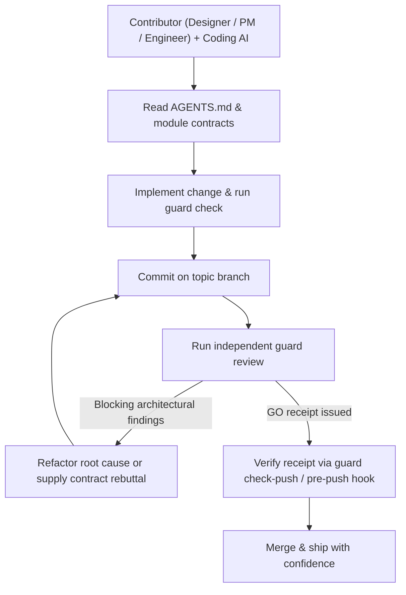

# the-guard

[](LICENSE)
[](pyproject.toml)
[](pyproject.toml)

**Let your whole team build with AI.**

Architecture guardrails for teams building software with AI.

AI has made writing code effortless. The real bottleneck today is **trust**: who dares to let AI-generated changes land directly in production? A feature can work and pass tests while placing a business rule in the wrong service, duplicating a state machine, or leaving an obsolete code path alive.

`the-guard` embeds your team's architectural principles directly into the repository—guiding coding agents before they write a line of code, catching structural regressions during development, and running an independent adversarial agent review before integration.

[中文文档](README.zh-CN.md) · [Quick start](#quick-start) · [Workflow](#workflow) · [Configuration](#configuration) · [Setup skill](skills/the-guard-setup/SKILL.md)

## Why we built it

On our team, our product designer uses her own ChatGPT and coding agent to implement her own product requirements directly in production code. This isn't a hackathon demo—it is how we ship software every day.

Working this way changed our core engineering question: **How do we let designers, product managers, domain experts, and engineers ship features with their preferred AI—without needing a senior architect to babysit every pull request?**

Tests verify that a feature works. Linters, formatters, and static analyzers catch style issues and bug patterns. Yet a green CI pipeline still cannot tell whether a UI component just recreated a backend state machine, or whether a bug fix merely stacked a retry loop over a broken data model.

`the-guard` makes architectural intent executable and self-enforcing inside the repository:
- **Who owns each business decision** and where module boundaries lie.
- **What must be deleted** when a new path replaces an old one.
- **Whether a change solves the root cause** instead of patching symptoms.

When the repository itself carries and enforces these standards, anyone on the team can turn an idea into production-ready code with confidence.

## Three defenses, one set of rules

| Stage | Defense | What it does |
| --- | --- | --- |
| **1. Before coding** | **Upfront rules in `AGENTS.md` / `CLAUDE.md`** | Puts architectural policies and module ownership contracts directly in front of the coding agent before implementation begins. |
| **2. During editing** | **Deterministic topology checks & ratchets** | Enforces module import boundaries, exclusive SQL table ownership, retired-table ratchets, and AST/lexical anti-pattern checks via `guard check`. |
| **3. Before merge** | **Independent adversarial agent review** | Launches a separate reviewer agent (`codex`, `claude`, or `agy`) against committed Git snapshots to challenge ownership, complexity, and root-cause design before issuing a push receipt. |

Static checks enforce deterministic structural facts; independent agent review evaluates architectural meaning.

## Quick start

### 1. Install

With Python 3.11+ and Git installed:

```sh
python3 -m pip install /path/to/the-guard
```

Or run `/path/to/the-guard/bin/guard` directly from a checkout. The CLI has **zero external runtime dependencies**; independent review uses your locally installed `codex`, `claude`, or `agy` CLI.

### 2. Initialize in 30 seconds

Inside your Git repository:

```sh
guard init --preset core
guard topology sync
guard check --policy-only
```

This installs four foundational rules—**Architecture Simplicity**, **Single Source of Truth**, **Service Boundaries**, and **Code Organization**—discovers your module inventory, and validates the policy manifest.

Want to install the full 14-rule engineering standard and enable the local `pre-push` gate?

```sh
guard init --preset full --with-hooks
```

### 3. Or let your agent set it up interactively

Register [the-guard-setup](skills/the-guard-setup/SKILL.md) in your agent's skill directory and invoke `$the-guard-setup`. It guides you through four onboarding modes:
- **core**: 4 foundational architectural rules.
- **full**: All 14 production engineering quality rules.
- **distill**: Distill architecture rules tailored to your existing codebase (`guard distill`).
- **hybrid**: Combine core presets with codebase-specific module boundaries.

## Workflow



1. **Align upfront**: The coding agent reads root policies in `AGENTS.md` and touched modules' owner docs.
2. **Check deterministically**: Run `guard check --base origin/main` during development to catch boundary or AST violations immediately.
3. **Commit & review**: Commit changes on a topic branch and run `guard review`. An independent reviewer agent audits the committed diff against your rules.
4. **Converge or rebut**: If the reviewer flags a structural issue, fix the root cause across the pattern—or rebut with code/contract evidence via `guard review --note "<evidence>"`.
5. **Gate integration**: `guard check-push` (or the `pre-push` hook installed by `--with-hooks`) verifies that a valid `GO` receipt matches the committed patch before pushing to `main`.

### A concrete example

Suppose a designer asks her coding agent to add an order-status badge to a screen, and the agent computes the status rule directly inside the UI component—duplicating logic already owned by the orders service.

- A traditional linter sees valid syntax and types.
- `guard check` blocks forbidden cross-layer imports deterministically.
- `guard review` reads the orders service contract, flags the duplicated business rule under `guard.single-source-of-truth`, and asks the contributor's agent to consume the backend's canonical status field instead.

The contributor's agent fixes the implementation in one turn, re-runs `guard review`, receives a `GO` receipt, and ships clean architecture without waiting on a human code review bottleneck.

## Where it fits

`the-guard` complements your existing engineering toolchain:

| Tool category | What it does best | What `the-guard` adds |
| --- | --- | --- |
| **Linters & formatters** ([Ruff](https://github.com/astral-sh/ruff), ESLint) | Fast checks for syntax, style, formatting, and local bug patterns. | Semantic ownership rules and cross-module architectural review. |
| **Static & security analyzers** ([Semgrep](https://github.com/semgrep/semgrep)) | Pattern-based security and correctness rules. | A unified contract linking agent instructions, module docs, and adversarial design review. |
| **Dependency validators** ([dependency-cruiser](https://github.com/sverweij/dependency-cruiser)) | Language-specific dependency graphs and import rules. | Zero-config Python/Swift topology ratchets paired with LLM architectural judgment. |
| **Coding agents** (ChatGPT, Claude Code, Codex) | Write features, refactor code, and fix bugs rapidly. | An independent second opinion that challenges shortcuts before code lands on `main`. |

## Core philosophy

1. **One decision, one owner (`guard.single-source-of-truth`)**: Every business rule, state machine, vocabulary, and classification has a single canonical owner. Consumers render or forward results instead of re-deriving them.
2. **Simplify at the source (`guard.architecture-simplicity`)**: Fix root causes at the owner boundary. Delete replaced code paths, legacy tables, and compatibility shims in the same change rather than stacking retries or fallback branches.
3. **Preserve real safety boundaries**: Simplification never removes authentication, tenant isolation, concurrency locks, idempotency, or transactional integrity at the write boundary.
4. **Evidence over ceremony**: Reviewers must cite concrete file paths and contract violations. When the code is already right, a factual rebuttal (`guard review --note`) resolves the finding without cosmetic churn.

See the [core rule definitions](docs/standards/rules/architecture-simplicity.md) and the full 14-rule [preset catalog](skills/the-guard-setup/references/preset-catalog.md).

## Independent review

`the-guard` discovers locally available agent CLIs (`codex > claude > agy` by default) and runs reviews against committed Git snapshots:

```sh
guard probe --priority-order codex,claude,agy
guard probe --provider-model codex=gpt-5.4:high
guard review --provider codex
guard review run --force
guard review check-push
```

- **Full vs. incremental follow-up**: Initial reviews inspect the complete changed file scope before reporting all high-confidence blockers. Subsequent runs on the same branch resume the verified reviewer session to audit fixes and new deltas.
- **Snapshot discipline**: Review prompts bind reads to committed Git refs (`base..head`) and forbid writes, test execution, or subagent spawning during review.
- **Patch-equivalent receipts**: Receipts (`the-guard-receipt/v1`) bind to Git stable patch IDs and patch digests under `.git/the-guard-receipts/`, allowing clean rebases onto an updated `main` to carry forward verified review evidence automatically.

## Configuration

`.guard/config.json` is optional—out of the box, `guard` reads the policy block in `AGENTS.md`. Add `.guard/config.json` when you want custom paths, review scopes, or declarative topology constraints:

```json
{
  "manifest_file": "AGENTS.md",
  "manifest_tag": "the-guard-policy",
  "manifest_schema": "the-guard-policy/v1",
  "detail_dir": "docs/standards/rules",
  "detail_manifest_ref": "AGENTS.md#engineering-quality-policy",
  "rule_id_prefix": "guard.",
  "exempt_tag": "guard-exempt",
  "main_branch": "main",
  "module_doc_roots": ["services", "packages", "apps", "modules", "src"],
  "review": {
    "project_title": "My project",
    "reviewable_extensions": [".py", ".swift", ".ts", ".tsx", ".js", ".go", ".rs"],
    "reviewable_prefixes": ["infra/"],
    "extra_reviewable_paths": ["docs/architecture/**"],
    "service_config_roots": ["services", "packages", "apps", "src"]
  },
  "topology": {
    "python_prod_prefixes": ["src/", "services/", "packages/", "app/", "apps/"],
    "swift_prod_prefixes": [""],
    "modules": [],
    "forbidden_imports": [{"from": "src/ui/", "to": "internal.storage"}],
    "exclusive_sql_owners": [
      {
        "table": "jobs",
        "owners": ["src/storage/jobs.py"],
        "rule_id": "guard.single-source-of-truth",
        "message": "Use the jobs owner API."
      }
    ],
    "retired_tables": [
      {"scope_prefixes": ["src/"], "tables": ["old_jobs"], "rule_id": "guard.data-modeling"}
    ],
    "forbidden_patterns": [
      {
        "scope_prefixes": ["src/ui/"],
        "literal_or_regex": "/private-owner-state",
        "literal": true,
        "rule_id": "guard.service-boundaries",
        "message": "Consume the public owner projection."
      }
    ]
  }
}
```

- **Policy manifest**: Stored between `<!-- the-guard-policy:start -->` and `<!-- the-guard-policy:end -->` in `AGENTS.md`:
  ```yaml
  schema: the-guard-policy/v1
  rules:
    - id: guard.service-boundaries
      severity: block
      scope: [backend, frontend]
      summary: Each module owns only its declared responsibilities.
      details: docs/standards/rules/service-boundaries.md
      checker: static-plus-review
  ```
- **Inline exemptions**: Suppress a specific static finding with a concrete justification (`>= 8` chars):
  `# guard-exempt guard.architecture-simplicity: concrete reason here`
- **Environment variables**: Configure reviewer behavior via `THE_GUARD_REVIEW_CONFIG`, `THE_GUARD_REVIEW_PROVIDER`, `THE_GUARD_REVIEW_MODEL`, `THE_GUARD_REVIEW_EFFORT`, `THE_GUARD_REVIEW_STALL_SECONDS`, `THE_GUARD_REVIEW_HEARTBEAT_SECONDS`, `THE_GUARD_REVIEW_MAX_SECONDS`, and `THE_GUARD_REVIEW_LOG_DIR`. Provider discovery persists to `~/.config/the-guard/review-agent.json`.

## Topology checks and CLI reference

```sh
guard distill --repo-root . --json
guard topology sync --repo-root .
guard topology check --base origin/main
guard check --file src/api.py --file app/Screen.swift --json
```

| Check layer | What it enforces |
| --- | --- |
| **Python AST checks** | Write locks inside read-only functions/endpoints; duplicate awaited reads on the same execution path without an intervening write; single-entity awaited reads inside loops/comprehensions. |
| **Swift lexical checks** | Duplicate awaited reads within the same function scope. |
| **Declared topology rules** | `forbidden_imports` (`module_boundaries`), `exclusive_sql_owners`, `retired_tables`, and `forbidden_patterns`. |
| **Legacy debt ratchets** | Baseline-aware line & function-signature matching so legacy files only fail when a change introduces new violations or fails to reduce touched `retired_tables` references. |

### Commands and exit codes

| Command | Purpose |
| --- | --- |
| `guard init` | Initialize policy manifest and rule files (`--preset core\|full`, `--with-hooks`, `--rules-dir`, `--manifest-file`). |
| `guard check` | Validate policy manifest and run deterministic topology checks on changed files (`--policy-only`, `--base`, `--file`, `--json`). |
| `guard topology sync` / `check` | Sync discovered module inventory into `.guard/config.json` or run topology checks standalone. |
| `guard distill` | Emit repository module inventory, tooling signals, and code samples for agent-assisted rule distillation. |
| `guard review` / `guard review run` | Run independent agent architecture review on committed changes (`--provider`, `--force`, `--note`). |
| `guard check-push` | Verify that current `HEAD` has a matching `GO` review receipt or is review-exempt ( ordinary prose / lockfile-only changes). |
| `guard probe` | Discover and configure local reviewer agent CLIs (`--priority-order`, `--provider-model`, `--reprobe`). |
| `guard hook edit-guard` | Post-edit hook for coding agents (reads `tool_input.file_path` from JSON stdin). |
| `guard hook main-push-gate` | Git `pre-push` hook enforcing valid review receipts before pushing to protected branches. |

Exit codes: `0` pass (`GO` or exempt), `2` blocking policy/topology/review findings, `3` checker or reviewer provider unavailable.

## Development

`the-guard` dogfoods its own core preset and deterministic checks:

```sh
uv run python -m unittest discover -s tests -v
uv run guard check --base HEAD
```

See [src/the_guard/README.md](src/the_guard/README.md) for internal package architecture and module boundaries.

## License

[MIT](LICENSE)
