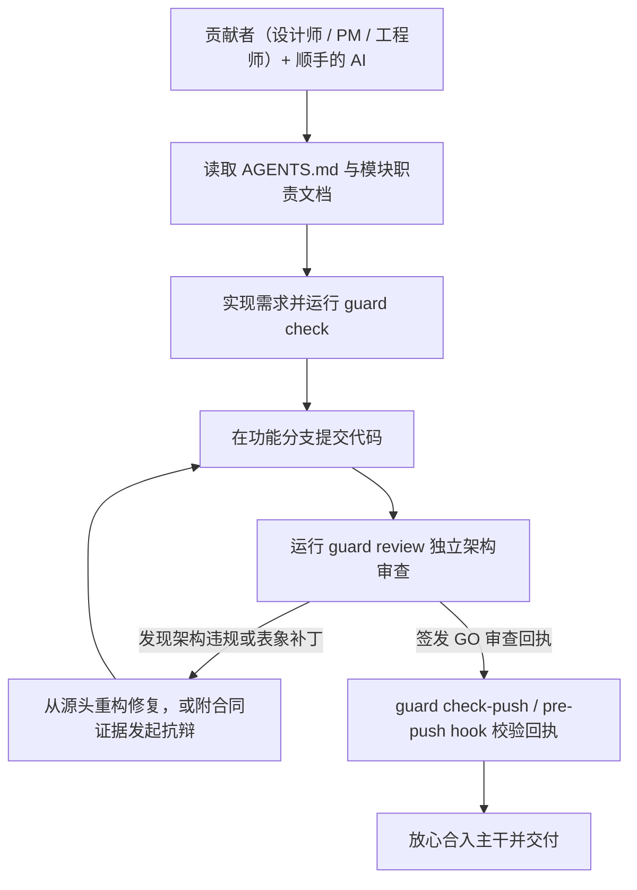

# the-guard

[](LICENSE)
[](pyproject.toml)
[](pyproject.toml)
[](https://skills.sh/sensebeing/the-guard)
[](https://github.com/sensebeing/the-guard/stargazers)

**让团队里的每个人，都能放心用 AI 写代码。**

面向 AI 研发团队的架构护栏与独立审查门禁。

现在任何人都能用 AI 写出能跑的代码，真正的难点是守住代码库的架构一致。一个功能哪怕通过了测试，背后也可能把业务规则塞进了错误的服务、复制了一套状态机，或者在上线新逻辑后留着旧的写入路径继续污染数据。

`the-guard` 把团队的架构规则放进仓库：AI 动笔前先读边界契约，改代码时用确定性拓扑棘轮拦截违规，合入前再拉起一个独立 Agent 对已提交代码做对抗式架构审查。

| 没有 `the-guard` | 接入 `the-guard` |
| --- | --- |
| 编码 Agent 在前端组件里重算了一遍订单状态规则，或者在报错的查询外包了一层重试。单元测试和 Linter 全部通过，这种偷懒补丁被合入 `main`。 | 编码 Agent 动笔前先读取 `AGENTS.md` 与模块职责文档；开发时 `guard check` 拦截越界导入与 SQL 写归属违规；合入前 `guard review` 拉起独立审查 Agent，依据 `guard.single-source-of-truth` 要求在唯一 Owner 边界内从源头修复。 |

[English](README.md) · [快速开始](#快速开始) · [预设与规则](#四档预设与-14-条工程质量规范) · [日常工作流](#日常工作流) · [配置参考](#配置参考) · [接入技能](skills/the-guard-setup/SKILL.md) · [日常技能](skills/the-guard/SKILL.md) · [基准评测](#基准评测)

## 30 秒上手：复制给你的 Agent

把下面这段话发给 Claude Code、Codex、Cursor、Antigravity 或 Orca：

```text
请为当前仓库安装并配置 https://github.com/sensebeing/the-guard。
安装 CLI（`uv tool install git+https://github.com/sensebeing/the-guard` 或 `python3 -m pip install git+https://github.com/sensebeing/the-guard`），
安装技能（`npx skills add sensebeing/the-guard --global --agent '*'` 或从本地检出目录创建软链），
然后按 skills/the-guard-setup/SKILL.md 引导我选择接入模式（core、full、distill 或 hybrid）并完成 guard check 验证。
```

## 为什么做这个工具

在我们团队，产品设计师每天都用她自己的 ChatGPT 和 Coding Agent，把她自己提的产品需求直接实现到生产代码里。当设计师、产品经理、业务专家和工程师都能用各自顺手的 AI 直接提需求、改代码、发生产时，不可能靠一位资深架构师跟在每个人身后盯每一次提交。

单元测试能验证功能，Linter、格式化工具和静态扫描能检查代码风格与常见缺陷。但就算 CI 全绿，传统工具也判断不了前端组件是不是把后端的状态机重写了一遍，或者一次故障修复是不是只在错误的数据模型上又套了一层重试。

`the-guard` 把这些架构要求直接写进仓库：哪项业务决策归哪个模块唯一负责，新路径替换旧路径时哪些旧表和旧分支必须一并删除，以及改动是否真正从源头解决了问题。

## 三道防线，同一套规则

| 阶段 | 防线 | 作用 |
| --- | --- | --- |
| 1. 写代码前 | `AGENTS.md` / `CLAUDE.md` 前置契约 | 在编码 Agent 动笔前提供工程规则清单与各模块的职责边界文档。 |
| 2. 开发过程中 | 确定性拓扑检查与技术债棘轮 | 通过 `guard check` 检查模块导入边界、SQL 表独占写权限、退役表清理与 AST 反模式；对历史遗留文件实行只减不增的棘轮控制。 |
| 3. 合入主干前 | 独立 Agent 对抗式架构审查 | 通过 `guard review` 拉起另一个独立 Agent（`codex`、`claude` 或 `agy`），基于已提交的 Git 快照质询职责归属、端到端调用链与过度设计，通过后签发合入回执。 |

## 快速开始

### 1. 安装

需 Python 3.11+ 与 Git 环境，可直接从 GitHub 安装 `guard` CLI：

```sh
uv tool install git+https://github.com/sensebeing/the-guard
# 或使用 pip：
python3 -m pip install git+https://github.com/sensebeing/the-guard
```

为 Claude Code、Codex、Cursor、Gemini CLI、GitHub Copilot 或 Windsurf 安装技能（`$the-guard` 与 `$the-guard-setup`）：

```sh
npx skills add sensebeing/the-guard --global --agent '*'
```

在 Claude Code 中也可以通过插件市场安装：

```text
/plugin marketplace add sensebeing/the-guard
/plugin install the-guard@the-guard
```

CLI 无外部运行时依赖；独立架构审查会调用本机已安装并登录的 `codex`、`claude` 或 `agy` CLI。

### 2. 初始化

在 Git 仓库根目录下运行：

```sh
guard init --preset core
guard topology sync
guard check --policy-only
```

这会安装四条核心规则（架构简洁、唯一真源、服务边界、代码组织），扫描仓库模块清单并校验策略配置。

如需直接安装完整 14 条工程质量规则并启用本地 `pre-push` 门禁：

```sh
guard init --preset full --with-hooks
```

### 3. 或通过技能交互式接入

在编码 Agent 中调用 `$the-guard-setup`（或 `/the-guard-setup`），即可按提示选择 `core`、`full`、`distill` 或 `hybrid` 接入模式。

## 四档预设与 14 条工程质量规范

| 模式 | 适用场景 | 包含内容 |
| --- | --- | --- |
| `core` | 推荐默认（4 条规则） | 不依赖具体技术栈的通用架构不变量：唯一真源、架构简洁、服务边界、代码组织。 |
| `full` | 生产全栈（14 条规则） | 全部 4 条核心规则，再加 10 条专项规则，覆盖数据建模、SQL 与调用拓扑效率、事件驱动执行、过程附属信息分离、显式失败处理、前端设计系统消费、Agent/Skill/Prompt 合同、LLM 输入输出合同、工具 Schema 编写及常驻测试质量。 |
| `distill` | 从代码库提炼 | `guard distill` 扫描现有模块、工具链与代码样本，由 Agent 提炼贴合当前代码库的规则。 |
| `hybrid` | 核心规则 + 代码库拓扑 | 4 条核心规则，加上从代码库提炼的模块边界、SQL 表归属与退役表棘轮。 |

`core` 和 `full` 是 `guard init --preset` 的内置选项，`distill` 与 `hybrid` 由 Agent 引导完成。扫描结果仅作候选依据，将项目边界设为阻塞规则前需先确认 Owner。

### 核心预设（4 条）

| 规则 | 守护领域 | 核心不变量 |
| --- | --- | --- |
| `guard.architecture-simplicity`<br>[架构简洁](src/the_guard/presets/rules/architecture-simplicity.md) | 职责归属与写收敛 | 每项职责与写入决策只有一个明确 Owner；在写入时收敛，读取直接消费权威结果，不加写锁、不反查重算；删除被替代的机制，不叠加防御性复查。 |
| `guard.single-source-of-truth`<br>[唯一真源](src/the_guard/presets/rules/single-source-of-truth.md) | 权威状态与单轨切流 | 每条业务规则、状态机、词表和过滤条件只有一个可执行定义；同一次变更完成读切流与旧逻辑删除，不保留双轨兜底读取。 |
| `guard.service-boundaries`<br>[服务边界](src/the_guard/presets/rules/service-boundaries.md) | 模块边界契约 | 各模块只承担其 Owner 合同声明的职责；共享库和 UI 不复制垂直领域的业务逻辑。 |
| `guard.code-organization`<br>[代码组织](src/the_guard/presets/rules/code-organization.md) | 职责内聚与无环依赖 | 模块、类、方法职责内聚，依赖无环，导入置于顶层，并删除死代码；不机械拆文件，不通过 MRO 遮蔽同名方法。 |

### 完整预设新增（10 条）

| 规则 | 守护领域 | 核心不变量 |
| --- | --- | --- |
| `guard.data-modeling`<br>[数据建模](src/the_guard/presets/rules/data-modeling.md) | Schema 与退役表清理 | Schema 归属明确、语义稳定；派生数据不成为竞争真源；退役表只做删除清理。 |
| `guard.database-query-efficiency`<br>[数据库查询效率](src/the_guard/presets/rules/database-query-efficiency.md) | 调用扇出、N+1 与锁纪律 | 控制端到端调用扇出与 SQL 成本；单次操作不重复只读拉取，循环内不做 N+1 异步读取，数据库锁内不调用 RPC/LLM；无锁结算采用 CAS 或版本校验。 |
| `guard.event-driven-execution`<br>[事件驱动执行](src/the_guard/presets/rules/event-driven-execution.md) | 事件驱动与异步队列水位 | 由真实事件或消息驱动执行；异步队列保证单水位发现、逐行终态结算和防饥饿；不使用未经批准的轮询或定时器。 |
| `guard.process-adjunct-not-truth`<br>[过程附属信息，不是业务真相](src/the_guard/presets/rules/process-adjunct-not-truth.md) | 业务真源与过程元数据分离 | 构建指纹、提示词版本与运行时元数据属于过程附属信息，不是业务真相；恢复与续跑依据业务义务和安全可重试性。 |
| `guard.no-silent-fallback`<br>[禁止静默兜底](src/the_guard/presets/rules/no-silent-fallback.md) | 显式失败隔离 | 不编造事实，不用静默默认值掩盖失败；隔离未知部分，只阻断受影响的不安全操作。 |
| `guard.frontend-product-surface`<br>[前端产品界面](src/the_guard/presets/rules/frontend-product-surface.md) | 设计系统消费链 | 按设计系统、通用组件到页面的顺序消费；业务状态、导航与展示各归其主。 |
| `guard.agent-skill-prompt`<br>[Agent、Skill 与 Prompt 合同](src/the_guard/presets/rules/agent-skill-prompt.md) | 提示词与运行时门禁对称 | 技能、提示词、工具 Schema 与运行时门禁保持对称；运行时注入确定性上下文，代码执行硬安全门禁，提示词不复制状态机或 Schema。 |
| `guard.llm-contract-quality`<br>[LLM 输入与合同质量](src/the_guard/presets/rules/llm-contract-quality.md) | 模型输入输出契约 | 模型输入区分已确认事实与候选信息；归一化合法变体，保留解析与拒绝诊断，不猜测身份或业务事实。 |
| `guard.tool-authoring`<br>[工具编写](src/the_guard/presets/rules/tool-authoring.md) | 扁平工具 Schema 与生命周期 | 每个工具只负责一个领域资源，授权语义一致；使用扁平、按 action 区分的 Schema，不嵌套信封、不用平行数组或开放字典；只暴露意图参数，退役工具端到端删除。 |
| `guard.test-case-quality`<br>[测试用例质量](src/the_guard/presets/rules/test-case-quality.md) | 高信噪比不变量测试 | 常驻测试守护核心业务不变量并说明失败含义；断言可观察行为，不只验证 mock 调用，也不镜像源码文本。 |

## 日常工作流



1. 编码 Agent 在修改前先读取根策略 `AGENTS.md` 与所触及模块的职责文档。
2. 开发过程中运行 `guard check --base origin/main`，及时拦截跨层引用或 AST 违规。
3. 在功能分支提交代码后运行 `guard review`，由另一个独立审查会话对本次已提交的改动做架构审查。
4. 遇到阻塞项时，从架构源头修正整类问题；如果现有实现确实符合模块合同，可用 `guard review --note "<代码位置与合同证据>"` 提交证据发起抗辩。
5. 推送主分支前，通过 `guard check-push`（或 `--with-hooks` 安装的 `pre-push` 钩子）核验本地 `GO` 回执。

### 日常场景示例

假设设计师让她的 Coding Agent 在页面上加一个订单状态标签，Agent 直接在前端组件里写了一段状态判断逻辑，而这项状态计算本来由后端订单服务唯一负责。

传统 Linter 看到语法和类型合法就会放行。`guard check` 会拦截前端对内部存储层的越界引用，`guard review` 则对照订单服务的职责合同，依据 `guard.single-source-of-truth` 指出前端重复实现了状态机，要求改为读取后端返回的字段。设计师把这条反馈发回给她的 Agent，改成直接读取后端字段，重跑 `guard review` 拿到 `GO` 回执后即可合入主干。

## 与现有工具如何配合

| 工具类别 | 擅长解决什么 | `the-guard` 补充什么 |
| --- | --- | --- |
| Linter 与格式化工具（[Ruff](https://github.com/astral-sh/ruff)、ESLint） | 检查语法、代码风格、格式化与局部代码缺陷。 | 跨模块的业务职责归属判定与架构审查。 |
| 静态与安全扫描器（[Semgrep](https://github.com/semgrep/semgrep)） | 基于模式匹配的安全漏洞与已知缺陷扫描。 | 将编码前 Agent 指令、模块职责文档与合入前独立审查串成闭环。 |
| 依赖校验工具（[dependency-cruiser](https://github.com/sverweij/dependency-cruiser)） | 特定语言的依赖图与导入规则检查。 | Python 与 Swift 拓扑棘轮，配合 LLM 架构审查。 |
| 编码 Agent（ChatGPT、Claude Code、Codex） | 编写功能、重构代码、定位问题。 | 引入独立审查会话，在代码合入 `main` 前拦截偷懒补丁与架构退化。 |
| AI PR 审查器与上下文图谱（CodeRabbit、Greptile、PR-Agent、code-review-graph） | PR 差异缺陷挖掘、摘要与 AST 调用图检索。 | 用一套共享合同串起编码前的 `AGENTS.md` 与模块 Owner 文档；编辑时以零 Token 拓扑与技术债棘轮拦截退化；合入前做带本地推送回执的对抗式审查。 |

## 基准评测

`the-guard` 同时接受架构退化样本与真实 PR 的双轨评测；案例与复现方式见[GuardBench 与 ReviewBench](benchmarks/README.md)。

| 轨道 / 指标 | Ruff (E,F,B) | `guard check`（确定性） | 裸 Codex 审查（gpt-5.4，无合同） | `the-guard`（`guard check` + `guard review`） |
| --- | --- | --- | --- | --- |
| 轨道 1 — GuardBench 腐化案例检出 | 0/6 | 4/6（66.7%） | 6/6 | 6/6（100%） |
| 轨道 1 — 违规召回 | 0/12 | 5/12 | 7/12（58.3%） | 12/12（100%） |
| 轨道 1 — 修复方向质量 | 无 | 静态项精确 | 3 个反架构建议（案例 4、5、6） | 12/12 对齐根因 |
| 轨道 1 — Clean case-7 误报 / 输入 Token | 0 / 0 | 0 / 0 | 1 / 352,664 | 0 / 205,866 |
| 轨道 2 — ReviewBench 金标准 TP 召回（3 个 PR） | — | — | 3/5 | 5/5（100%） |
| 轨道 2 — TechDebtMCP#135 标注 ReDoS 误报 | — | — | 1 | 0 |
| 轨道 2 — TechDebtMCP#135 输入 Token | — | — | 445,432 | 258,950（少 41.9%） |

确定性层在约 40ms、0 Token 下拦截结构退化；审查层依据合同要求从根因修复。ReviewBench 抽样的 5 项真实问题全部命中，其中包括 `guard.no-silent-fallback` 标出的标志剥离缺陷，同时避开标注的 ReDoS 误报。

复现命令：`python3 benchmarks/guardbench.py`；详见 [benchmarks/README.md](benchmarks/README.md)。

## 设计原则

1. `guard.single-source-of-truth`：每条业务规则、状态机、词表和分类逻辑只有一个权威定义，UI、技能与下游模块直接消费结果，不各自重算。
2. `guard.architecture-simplicity`：在唯一 Owner 边界内解决根因；替换旧机制时在同一提交内完成读切流与旧代码、旧表清理，不叠重试、开关或新旧双读分支。
3. 守住真实安全边界：简化代码时保留跨信任边界与写入落点上的鉴权、租户隔离、并发锁、幂等与事务完整性保护。
4. 重证据而非形式：审查必须给出具体代码路径与合同依据；当实现本身正确时，可通过 `guard review --note` 提交证据消除误报，无需做表面修改。

详见[核心规则定义](docs/standards/rules/architecture-simplicity.md)与完整 14 条规则的[预设目录](skills/the-guard-setup/references/preset-catalog.md)。

## 独立架构审查

`the-guard` 自动探测本机可用的 Agent CLI（默认优先级：`codex > claude > agy`），并基于已提交的 Git 快照执行审查：

```sh
guard probe --priority-order codex,claude,agy
guard probe --provider-model codex=gpt-5.4:high
guard review --provider codex
guard review run --force
guard review check-push
```

首次审查会读完变更范围内的全部文件批次，一次性列出所有高置信度阻塞项；同一分支后续复审会续接已验证的审查会话，核查前序问题是否解决以及新增差异。审查提示词将读取范围限制在已提交的 Git 快照（`base..head`），禁止审查会话写文件、跑测试或派发子 Agent。审查回执（`the-guard-receipt/v1`）按 Git stable patch ID 与补丁摘要保存在 `.git/the-guard-receipts/` 下，分支 rebase 到最新 `main` 且补丁内容等价时会自动复用。

## 配置参考

`.guard/config.json` 为可选项。默认情况下，`guard` 直接读取 `AGENTS.md` 中的策略清单。需要定制目录、审查范围或声明式拓扑约束时，可在仓库根目录配置 `.guard/config.json`（多服务完整样板见 [examples/config.example.json](examples/config.example.json)）：

```json
{
  "manifest_file": "AGENTS.md",
  "detail_dir": "docs/standards/rules",
  "main_branch": "main",
  "topology": {
    "forbidden_imports": [{"from": "src/ui/", "to": "internal.storage"}],
    "exclusive_sql_owners": [
      {
        "table": "jobs",
        "owners": ["src/storage/jobs.py"],
        "rule_id": "guard.single-source-of-truth",
        "message": "Use the jobs owner API."
      }
    ],
    "retired_tables": [
      {"scope_prefixes": ["src/"], "tables": ["old_jobs"], "rule_id": "guard.data-modeling"}
    ],
    "forbidden_patterns": [
      {
        "scope_prefixes": ["src/ui/"],
        "literal_or_regex": "/private-owner-state",
        "literal": true,
        "rule_id": "guard.service-boundaries",
        "message": "Consume the public owner projection."
      }
    ]
  }
}
```

策略清单嵌在 `AGENTS.md` 的 `<!-- the-guard-policy:start -->` 与 `<!-- the-guard-policy:end -->` 之间：

```yaml
schema: the-guard-policy/v1
rules:
  - id: guard.service-boundaries
    severity: block
    scope: [backend, frontend]
    summary: Each module owns only its declared responsibilities.
    details: docs/standards/rules/service-boundaries.md
    checker: static-plus-review
```

确需在代码中豁免某处静态检查时，可添加不少于 8 个字符的具体原因说明：
`# guard-exempt guard.architecture-simplicity: concrete reason here`

审查参数可通过环境变量 `THE_GUARD_REVIEW_CONFIG`、`THE_GUARD_REVIEW_PROVIDER`、`THE_GUARD_REVIEW_MODEL`、`THE_GUARD_REVIEW_EFFORT`、`THE_GUARD_REVIEW_STALL_SECONDS`、`THE_GUARD_REVIEW_HEARTBEAT_SECONDS`、`THE_GUARD_REVIEW_MAX_SECONDS` 与 `THE_GUARD_REVIEW_LOG_DIR` 覆盖，提供者探测结果默认保存在 `~/.config/the-guard/review-agent.json`。

## 拓扑检查与命令参考

```sh
guard distill --repo-root . --json
guard topology sync --repo-root .
guard topology check --base origin/main
guard check --file src/api.py --file app/Screen.swift --json
```

| 检查层 | 守护内容 |
| --- | --- |
| Python AST 检查 | 读函数或只读端点中误加写锁；同一执行路径无中间写入的重复 `await` 读取；循环或推导式内的单实体 N+1 异步读取。 |
| Swift 词法检查 | 同一函数作用域内的重复 `await` 读取。 |
| 声明式拓扑约束 | `forbidden_imports`（或 `module_boundaries`）、`exclusive_sql_owners`、`retired_tables` 与 `forbidden_patterns`。 |
| 历史技术债棘轮 | 结合变更行号与基线函数签名比对，未触及的历史违规不误报；触及 `retired_tables` 的文件必须实现引用数净减少。 |

### 命令与退出码

| 命令 | 用途 |
| --- | --- |
| `guard init` | 初始化策略清单与规则文档（`--preset core\|full`、`--with-hooks`、`--rules-dir`、`--manifest-file`）。 |
| `guard check` | 校验策略清单并对变更文件运行确定性拓扑检查（`--policy-only`、`--base`、`--file`、`--json`）。 |
| `guard topology sync` / `check` | 扫描模块清单同步至 `.guard/config.json`，或单独运行拓扑检查。 |
| `guard distill` | 输出模块清单、工具链信号与代码样本，供 Agent 提炼项目专属架构规则。 |
| `guard review` / `guard review run` | 对已提交变更执行独立 Agent 架构审查（`--provider`、`--force`、`--note`）。 |
| `guard check-push` | 校验当前 `HEAD` 是否具备有效 `GO` 审查回执或属于免审范围（普通文档或纯锁文件变更）。 |
| `guard probe` | 探测并配置本机可用的审查 Agent CLI（`--priority-order`、`--provider-model`、`--reprobe`）。 |
| `guard hook edit-guard` | 供编码 Agent 挂载的编辑后置钩子（从标准输入 JSON 读取 `tool_input.file_path`）。 |
| `guard hook main-push-gate` | Git `pre-push` 门禁钩子，保护主分支在缺少有效回执时拒绝推送。 |

退出码：`0` 通过（`GO` 或免审范围），`2` 存在阻塞项或策略无效，`3` 检查器或审查提供者不可用。

## 开发与自举测试

`the-guard` 使用自身的核心预设规则与静态检查守护自身代码库：

```sh
uv run python -m unittest discover -s tests -v
uv run guard check --base origin/main
```

内部包结构与模块职责边界见 [src/the_guard/README.md](src/the_guard/README.md)，环境搭建与审查要求见[贡献指南](CONTRIBUTING.md)，私密漏洞报告见[安全政策](SECURITY.md)，版本历史见[变更日志](CHANGELOG.md)。

## 相关开源项目

`the-guard` 是 SenseBeing 面向 AI 原生研发团队开源工具集的组成部分：

| 项目 | 作用 |
| --- | --- |
| [the-pilot](https://github.com/sensebeing/the-pilot) | 面向 Orca 编码 Agent 的场景化 Turn Autopilot 与多 Agent 编排引擎。 |
| [the-dealer](https://github.com/sensebeing/the-dealer) | 同机多 Agent 派发与跨机、跨团队加密 P2P 任务协同节点。 |

如果 `the-guard` 对你们团队用 AI 写代码有帮助，欢迎在 GitHub 点一颗 Star，让更多团队看到它。

## 许可证

[MIT](LICENSE)
