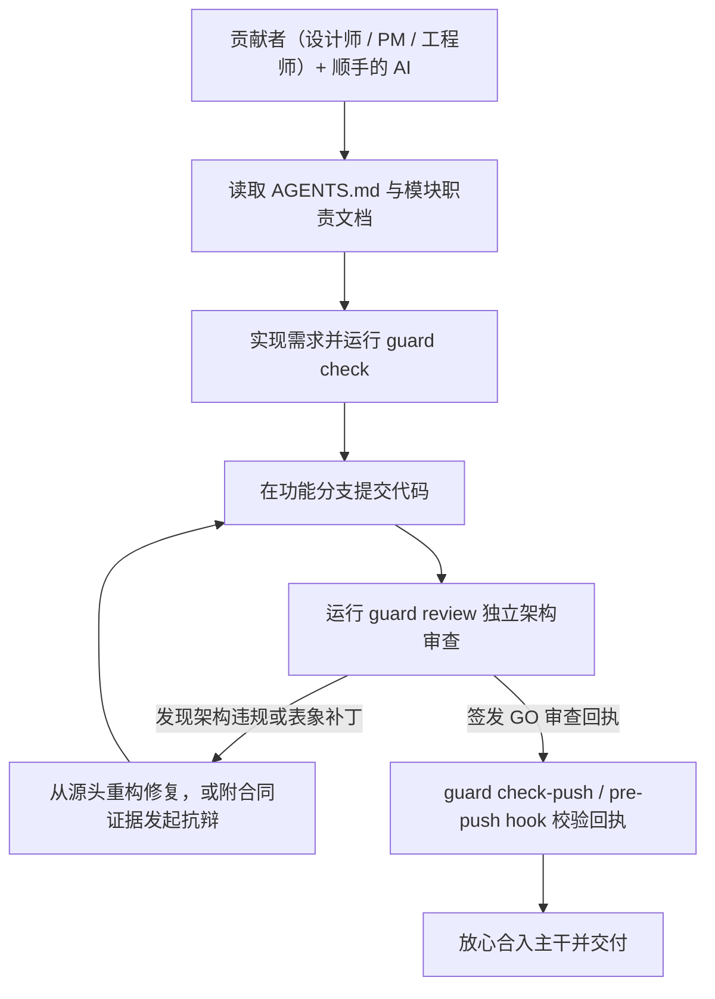

# the-guard

[](LICENSE)
[](pyproject.toml)
[](pyproject.toml)

**让团队里的每个人，都能放心用 AI 写代码。**

面向 AI 研发团队的架构护栏与独立审查门禁。

AI 已经让“写代码”不再是门槛，真正的门槛变成了**信任**：谁敢让 AI 生成的改动直接进生产环境？一个功能哪怕能跑通测试，背后也可能把业务规则塞进了错误的服务、复制了一套重复的状态机，或者在上线新逻辑后留着旧的写入路径继续污染数据。

`the-guard` 把团队的架构原则直接装进代码仓库——在 AI 动笔前注入边界契约，在改代码时用确定性拓扑棘轮拦截违规，在合入前自动拉起另一个独立 Agent 做对抗式架构审查。

[English](README.md) · [快速开始](#快速开始) · [预设与规则](#四档预设与-14-条工程质量规范) · [日常工作流](#日常工作流) · [配置参考](#配置参考) · [接入技能](skills/the-guard-setup/SKILL.md) · [日常技能](skills/the-guard/SKILL.md)

## 30 秒上手：复制给你的 Agent

把下面这段话粘贴给 Claude Code、Codex、Cursor、Antigravity 或 Orca：

```text
请为当前仓库接入 the-guard，保留我已有的指令和钩子。

1. 检查 `python3 --version`（要求 Python >= 3.11）和 `command -v guard`。
   如果尚未安装 `guard`，将 https://github.com/sensebeing/the-guard.git 克隆到 ~/the-guard
   （已有检出则用 `git -C ~/the-guard pull --ff-only` 更新），然后运行
   `python3 -m pip install -e ~/the-guard` 安装（也可以直接使用 `~/the-guard/bin/guard`）。
2. 将 `~/the-guard/skills/the-guard` 和 `~/the-guard/skills/the-guard-setup`
   以符号链接注册到已存在的 `~/.agents/skills/`、`~/.claude/skills/`、
   `~/.gemini/config/skills/` 目录，保留已有文件。
   阅读 `~/the-guard/skills/the-guard-setup/SKILL.md`。
3. 检查当前仓库的 `AGENTS.md`、`CLAUDE.md`、模块文档和 `.guard/config.json`，
   运行 `guard probe`，确认本机可用的审查 Agent（`codex`、`claude`、`agy`）。
4. 询问我希望采用哪种接入模式（`core`、`full`、`distill` 或 `hybrid`），
   以及是否安装本地 Git `pre-push` 门禁（`--with-hooks`）。
5. 初始化选定的预设或提炼后的策略，运行 `guard topology sync` 和
   `guard check --policy-only`，最后给我一份简明的日常操作速查表。
```

如果 `guard` 已安装在其他位置，请先定位源码检出目录（或克隆到 `~/the-guard`），供第 2 步注册技能。使用直接启动器时，将后续命令中的 `guard` 替换为 `~/the-guard/bin/guard`。

## 为什么做这个工具

在我们自己的团队里，产品设计师每天都在用她自己的 ChatGPT / Coding Agent，把她自己提的产品需求直接实现到生产代码里。这不是黑客松演示，而是我们每天真实的研发日常。

这种工作方式彻底改变了工程管理的核心命题：**怎样让团队里的设计师、产品经理、业务专家和工程师，都能用自己顺手的 AI 直接提需求、改代码、发生产，而不需要一位资深架构师时刻盯在每个人身后审每一行改动？**

单元测试能证明功能跑通，Linter、格式化工具和静态扫描能抓住语法风格与常见代码缺陷；但哪怕 CI 全绿，传统工具也回答不了一个核心问题：**这段业务逻辑到底该归哪个模块管？这次修复是治本，还是在错误的数据模型上又叠了一层重试补丁？**

`the-guard` 让架构意图随代码仓库一起流动并自动生效：
- **明确决策归属**：哪项业务状态归哪个模块唯一拥有，跨层边界在哪里。
- **拒绝新旧双轨**：新路径替代旧路径时，哪些旧表、旧状态分支必须在同一次提交里清理干净。
- **守住最简架构**：改动是从源头收敛问题，还是在报错处堆砌黑白名单与表象补丁。

当仓库自身就能守住架构红线时，团队里的任何人都能放心地用 AI 把想法直接变成高质量的生产代码。

## 三道防线，同一套规则

| 阶段 | 防线 | 作用 |
| --- | --- | --- |
| **1. 写代码前** | **`AGENTS.md` / `CLAUDE.md` 前置契约** | 在编码 Agent 动笔前，把核心工程规则与各模块的职责边界直接摆在它面前。 |
| **2. 开发过程中** | **确定性拓扑检查与技术债棘轮** | 通过 `guard check` 检查模块导入边界、SQL 表独占写权限、退役表清理与 AST 反模式；对历史遗留文件实行“只减不增”棘轮控制。 |
| **3. 合入主干前** | **独立 Agent 对抗式架构审查** | 通过 `guard review` 拉起另一个独立 Agent（`codex`、`claude` 或 `agy`），基于已提交的 Git 快照质询职责归属、端到端调用链与过度设计，通过后签发合入回执。 |

确定性的结构约束交给静态拓扑检查，深层的架构语义交给独立 Agent 审查。

## 快速开始

### 1. 安装

需 Python 3.11+ 与 Git 环境：

```sh
python3 -m pip install /path/to/the-guard
```

也可以直接运行检出目录下的 `/path/to/the-guard/bin/guard`。CLI **零外部运行时依赖**；独立架构审查会复用本机已安装并登录的 `codex`、`claude` 或 `agy` CLI。

### 2. 30 秒极速初始化

在你的 Git 仓库根目录下运行：

```sh
guard init --preset core
guard topology sync
guard check --policy-only
```

这会一键安装四条核心架构规则——**架构简洁（Architecture Simplicity）**、**唯一真源（Single Source of Truth）**、**服务边界（Service Boundaries）**、**代码组织（Code Organization）**——自动扫描仓库模块清单并完成策略校验。

如果希望直接接入完整 14 条工程质量标准并挂载本地 `pre-push` 门禁：

```sh
guard init --preset full --with-hooks
```

### 3. 或者让你的 Agent 引导式接入

将 [the-guard-setup](skills/the-guard-setup/SKILL.md) 注册到编码 Agent 的技能目录中，直接发送 `$the-guard-setup`，即可交互式选择四种接入方案：
- **core**：4 条最核心的架构防腐化规则，适合快速起步。
- **full**：完整 14 条生产级工程质量规则。
- **distill**：先运行 `guard distill` 扫描现有代码库，由 Agent 提炼贴合项目现状的专属规则。
- **hybrid**：核心预设规则 + 基于代码库提炼的模块拓扑约束。

## 四档预设与 14 条工程质量规范

| 模式 | 适用场景 | 包含内容 |
| --- | --- | --- |
| `core` | **推荐默认 — 4 条规则** | 不依赖技术栈的通用架构不变量：唯一真源、架构简洁、服务边界、代码组织。 |
| `full` | **生产全栈 — 14 条规则** | 全部 4 条核心规则，再加 10 条专项规则，覆盖数据建模、SQL 与调用拓扑效率、事件驱动执行、过程附属信息分离、禁止静默兜底、前端设计系统消费、Agent/Skill/Prompt 合同、LLM 输入与合同质量、工具 Schema 编写及常驻测试质量。 |
| `distill` | **从代码库提炼** | `guard distill` 检查现有模块、工具链与有界代码样本，由 Agent 提炼贴合代码库的规则。 |
| `hybrid` | **核心规则 + 代码库拓扑** | 4 条核心规则，加上从代码库提炼的模块边界、SQL 表归属与退役表棘轮。 |

`core` 和 `full` 是 `guard init --preset` 的内置选项；`distill` 与 `hybrid` 是由 Agent 引导的接入模式。扫描结果提供证据，不自动授予归属：执行项目专属边界约束前，先确认 Owner。

### 核心预设（4 条）

| 规则 | 守护领域 | 核心不变量 |
| --- | --- | --- |
| `guard.architecture-simplicity`<br>[架构简洁](src/the_guard/presets/rules/architecture-simplicity.md) | 职责归属与写收敛 | 每项职责与写入决策只有一个明确 Owner；在写入时收敛，读取直接消费权威结果，不加写锁、不反查重算；删除被替代的机制，不叠加防御性复查。 |
| `guard.single-source-of-truth`<br>[唯一真源](src/the_guard/presets/rules/single-source-of-truth.md) | 权威状态与单轨切流 | 每条业务规则、状态机、词表和过滤条件只有一个可执行定义；同一次变更完成读切流与旧逻辑删除，不保留双轨兜底读取。 |
| `guard.service-boundaries`<br>[服务边界](src/the_guard/presets/rules/service-boundaries.md) | 模块边界契约 | 各模块只承担其 Owner 合同声明的职责；共享库和 UI 不复制垂直领域的业务逻辑。 |
| `guard.code-organization`<br>[代码组织](src/the_guard/presets/rules/code-organization.md) | 职责内聚与无环依赖 | 模块、类、方法职责内聚，依赖无环，导入置于顶层，并删除死代码；不机械拆文件，不通过 MRO 遮蔽同名方法。 |

### 完整预设新增（10 条）

| 规则 | 守护领域 | 核心不变量 |
| --- | --- | --- |
| `guard.data-modeling`<br>[数据建模](src/the_guard/presets/rules/data-modeling.md) | Schema 与退役表清理 | Schema 归属明确、语义稳定；派生数据不成为竞争真源；退役表只做删除清理。 |
| `guard.database-query-efficiency`<br>[数据库查询效率](src/the_guard/presets/rules/database-query-efficiency.md) | 调用扇出、N+1 与锁纪律 | 控制端到端调用扇出与 SQL 成本；单次操作不重复只读拉取，循环内不做 N+1 异步读取，数据库锁内不调用 RPC/LLM；无锁结算采用 CAS 或版本校验。 |
| `guard.event-driven-execution`<br>[事件驱动执行](src/the_guard/presets/rules/event-driven-execution.md) | 事件驱动与异步队列水位 | 由真实事件或消息驱动执行；异步队列保证单水位发现、逐行终态结算和防饥饿；不使用未经批准的轮询或定时器。 |
| `guard.process-adjunct-not-truth`<br>[过程附属信息，不是业务真相](src/the_guard/presets/rules/process-adjunct-not-truth.md) | 业务真源与过程元数据分离 | 构建指纹、提示词版本与运行时元数据属于过程附属信息，不是业务真相；恢复与续跑依据业务义务和安全可重试性。 |
| `guard.no-silent-fallback`<br>[禁止静默兜底](src/the_guard/presets/rules/no-silent-fallback.md) | 显式失败隔离 | 不编造事实，不用静默默认值掩盖失败；隔离未知部分，只阻断受影响的不安全操作。 |
| `guard.frontend-product-surface`<br>[前端产品界面](src/the_guard/presets/rules/frontend-product-surface.md) | 设计系统消费链 | 严格遵循 Design System → Components → Pages 的消费方向；业务状态、导航与展示各归其主。 |
| `guard.agent-skill-prompt`<br>[Agent、Skill 与 Prompt 合同](src/the_guard/presets/rules/agent-skill-prompt.md) | 提示词与运行时门禁对称 | 技能、提示词、工具 Schema 与运行时门禁保持对称；运行时注入确定性上下文，代码执行硬安全门禁，提示词不复制状态机或 Schema。 |
| `guard.llm-contract-quality`<br>[LLM 输入与合同质量](src/the_guard/presets/rules/llm-contract-quality.md) | 模型输入输出契约 | 模型输入区分已确认事实与候选信息；归一化合法变体，保留解析与拒绝诊断，不猜测身份或业务事实。 |
| `guard.tool-authoring`<br>[工具编写](src/the_guard/presets/rules/tool-authoring.md) | 扁平工具 Schema 与生命周期 | 每个工具只负责一个领域资源，授权语义一致；使用扁平、按 action 区分的 Schema，不嵌套信封、不用平行数组或开放字典；只暴露意图参数，退役工具端到端删除。 |
| `guard.test-case-quality`<br>[测试用例质量](src/the_guard/presets/rules/test-case-quality.md) | 高信噪比不变量测试 | 常驻测试守护核心业务不变量并说明失败含义；断言可观察行为，不只验证 mock 调用，也不镜像源码文本。 |

## 日常工作流



1. **前置对齐**：编码 Agent 在修改前先读取根策略 `AGENTS.md` 与所触及模块的职责文档。
2. **即时自检**：开发时运行 `guard check --base origin/main`，秒级拦截跨层乱引或 AST 违规。
3. **提交与独立审查**：在功能分支提交代码后运行 `guard review`，由另一个独立审查会话对本次提交做不留情面的架构质询。
4. **源头收敛或有据抗辩**：遇到阻塞项时，引导 AI 从架构源头修正整类问题；若现有实现确实符合模块合同，可用 `guard review --note "<代码位置与合同证据>"` 发起有据抗辩。
5. **门禁放行**：`guard check-push`（或 `--with-hooks` 安装的 `pre-push` 钩子）在推送到受保护主分支前自动核验本地 `GO` 回执。

### 一个真实的日常场景

假设设计师用她的 Coding Agent 在界面上加一个订单状态标签，AI 图省事直接在前端组件里拼了一段状态判断逻辑——而这项状态决策其实早就有后端订单服务唯一负责。

- 传统 Linter 觉得语法、类型完全合法，一路绿灯。
- `guard check` 确定性地拦截前端对内部存储层的越界引用。
- `guard review` 对照订单服务的职责合同，依据 `guard.single-source-of-truth` 指出前端重复造了状态机，要求直接消费后端的权威字段。

设计师只需要把审查意见丢回给她的 AI，一轮改成直接消费后端字段，重新跑过 `guard review` 拿到 `GO` 回执，就能干干净净地合入主干——全程不需要架构师救火。

## 与现有工具如何配合

`the-guard` 与团队已有的工程工具链互补协作：

| 工具类别 | 擅长解决什么 | `the-guard` 在此之上补齐什么 |
| --- | --- | --- |
| **Linter 与格式化工具**（[Ruff](https://github.com/astral-sh/ruff)、ESLint） | 极速检查语法、代码风格、格式化与局部代码缺陷。 | 跨模块的业务职责归属判定与架构级对抗审查。 |
| **静态与安全扫描器**（[Semgrep](https://github.com/semgrep/semgrep)） | 基于模式匹配的安全漏洞与已知缺陷扫描。 | 将编码前 Agent 指令、模块职责文档与合入前独立审查串成闭环。 |
| **依赖校验工具**（[dependency-cruiser](https://github.com/sverweij/dependency-cruiser)） | 特定语言的依赖图与导入规则检查。 | 开箱即用的 Python/Swift 拓扑棘轮 + LLM 对“治本还是治标”的语义裁决。 |
| **编码 Agent**（ChatGPT、Claude Code、Codex） | 快速写功能、改代码、定位问题。 | 引入独立的“第二双眼睛”，在合入主干前拦截偷懒补丁与架构腐化。 |

## 核心设计理念

1. **一项决策，唯一 Owner（`guard.single-source-of-truth`）**：每条业务规则、状态机、词表和分类逻辑只有一个权威定义；UI、技能与下游消费者只消费结果，绝不各自重算。
2. **从源头治本（`guard.architecture-simplicity`）**：在唯一 Owner 边界内做根因收敛；替代旧机制时同周期完成读切流与旧代码/旧表清理，不叠重试、开关或新旧双读补丁。
3. **守住真实安全边界**：简化绝不削弱跨信任边界与写入落点上的鉴权、租户隔离、并发锁、幂等与事务完整性保护。
4. **证据优先，支持抗辩**：审查必须给出具体代码路径与合同依据；当实现本身正确时，开发者可通过 `guard review --note` 提交证据直接消解误报，无需为了讨好审查者做表面修改。

详见[核心规则定义](docs/standards/rules/architecture-simplicity.md)与完整 14 条规则的[预设目录](skills/the-guard-setup/references/preset-catalog.md)。

## 独立架构审查

`the-guard` 自动发现本机可用的 Agent CLI（默认优先级：`codex > claude > agy`），并基于已提交的 Git 快照执行审查：

```sh
guard probe --priority-order codex,claude,agy
guard probe --provider-model codex=gpt-5.4:high
guard review --provider codex
guard review run --force
guard review check-push
```

- **全量初审与增量复审**：首次审查要求读完变更范围内的全部文件批次并一次性列出所有高置信度阻塞项；同一分支后续复审自动续接已验证的审查会话，重点核查前序问题是否根治及新增增量。
- **Git 快照只读约束**：审查提示词将读取范围锁定在已提交的 Git 快照（`base..head`），并禁止审查会话修改文件、运行测试或套娃派发子 Agent。
- **基于补丁指纹的回执复用**：审查回执（`the-guard-receipt/v1`）保存在 `.git/the-guard-receipts/` 下，绑定 Git stable patch ID 与补丁摘要；当分支 rebase 到最新 `main` 且补丁内容等价时，无需重复跑大模型审查即可自动复用回执。

## 配置参考

`.guard/config.json` 为可选项——不建配置文件时，`guard` 直接读取 `AGENTS.md` 中的策略清单。需要定制目录、审查范围或声明式拓扑约束时，可在仓库根目录配置 `.guard/config.json`（完整多服务样板见 [examples/config.example.json](examples/config.example.json)）：

```json
{
  "manifest_file": "AGENTS.md",
  "detail_dir": "docs/standards/rules",
  "main_branch": "main",
  "topology": {
    "forbidden_imports": [{"from": "src/ui/", "to": "internal.storage"}],
    "exclusive_sql_owners": [
      {
        "table": "jobs",
        "owners": ["src/storage/jobs.py"],
        "rule_id": "guard.single-source-of-truth",
        "message": "Use the jobs owner API."
      }
    ],
    "retired_tables": [
      {"scope_prefixes": ["src/"], "tables": ["old_jobs"], "rule_id": "guard.data-modeling"}
    ],
    "forbidden_patterns": [
      {
        "scope_prefixes": ["src/ui/"],
        "literal_or_regex": "/private-owner-state",
        "literal": true,
        "rule_id": "guard.service-boundaries",
        "message": "Consume the public owner projection."
      }
    ]
  }
}
```

- **策略清单（Manifest）**：嵌在 `AGENTS.md` 的 `<!-- the-guard-policy:start -->` 与 `<!-- the-guard-policy:end -->` 之间：
  ```yaml
  schema: the-guard-policy/v1
  rules:
    - id: guard.service-boundaries
      severity: block
      scope: [backend, frontend]
      summary: Each module owns only its declared responsibilities.
      details: docs/standards/rules/service-boundaries.md
      checker: static-plus-review
  ```
- **行级豁免**：确需豁免某处静态检查时，附上不少于 8 个字符的具体原因：
  `# guard-exempt guard.architecture-simplicity: concrete reason here`
- **环境变量**：支持通过 `THE_GUARD_REVIEW_CONFIG`、`THE_GUARD_REVIEW_PROVIDER`、`THE_GUARD_REVIEW_MODEL`、`THE_GUARD_REVIEW_EFFORT`、`THE_GUARD_REVIEW_STALL_SECONDS`、`THE_GUARD_REVIEW_HEARTBEAT_SECONDS`、`THE_GUARD_REVIEW_MAX_SECONDS` 与 `THE_GUARD_REVIEW_LOG_DIR` 覆盖审查配置。探测结果默认保存在 `~/.config/the-guard/review-agent.json`。

## 拓扑检查与命令参考

```sh
guard distill --repo-root . --json
guard topology sync --repo-root .
guard topology check --base origin/main
guard check --file src/api.py --file app/Screen.swift --json
```

| 检查层 | 守护内容 |
| --- | --- |
| **Python AST 检查** | 读函数/只读端点中误加写锁；同一执行路径无中间写入的重复 `await` 读取；循环或推导式内的单实体 N+1 异步读取。 |
| **Swift 词法检查** | 同一函数作用域内的重复 `await` 读取。 |
| **声明式拓扑约束** | `forbidden_imports`（或 `module_boundaries`）、`exclusive_sql_owners`、`retired_tables` 与 `forbidden_patterns`。 |
| **历史技术债棘轮** | 结合变更行号与基线函数签名比对，未触及的历史违规不误报；触及 `retired_tables` 的文件必须实现引用数净减少。 |

### 命令与退出码

| 命令 | 用途 |
| --- | --- |
| `guard init` | 初始化策略清单与规则文档（`--preset core\|full`、`--with-hooks`、`--rules-dir`、`--manifest-file`）。 |
| `guard check` | 校验策略清单并对变更文件运行确定性拓扑检查（`--policy-only`、`--base`、`--file`、`--json`）。 |
| `guard topology sync` / `check` | 扫描模块清单同步至 `.guard/config.json`，或单独运行拓扑检查。 |
| `guard distill` | 输出模块清单、工具链信号与代码样本，供 Agent 提炼项目专属架构规则。 |
| `guard review` / `guard review run` | 对已提交变更执行独立 Agent 架构审查（`--provider`、`--force`、`--note`）。 |
| `guard check-push` | 校验当前 `HEAD` 是否具备有效 `GO` 审查回执或属于免审范围（纯文档/纯锁文件变更）。 |
| `guard probe` | 探测并配置本机可用的审查 Agent CLI（`--priority-order`、`--provider-model`、`--reprobe`）。 |
| `guard hook edit-guard` | 供编码 Agent 挂载的编辑后置钩子（从标准输入 JSON 读取 `tool_input.file_path`）。 |
| `guard hook main-push-gate` | Git `pre-push` 门禁钩子，保护主分支在缺少有效回执时拒绝推送。 |

退出码：`0` 通过（`GO` 或免审范围），`2` 存在阻塞项或策略无效，`3` 检查器或审查提供者不可用。

## 开发与自举测试

`the-guard` 使用自身的核心预设规则与静态检查守护自身代码库：

```sh
uv run python -m unittest discover -s tests -v
uv run guard check --base origin/main
```

内部包结构与模块职责边界详见 [src/the_guard/README.md](src/the_guard/README.md)。

环境搭建与审查要求见[贡献指南](CONTRIBUTING.md)，私密漏洞报告见[安全政策](SECURITY.md)，版本历史见[变更日志](CHANGELOG.md)。

## 许可证

[MIT](LICENSE)
